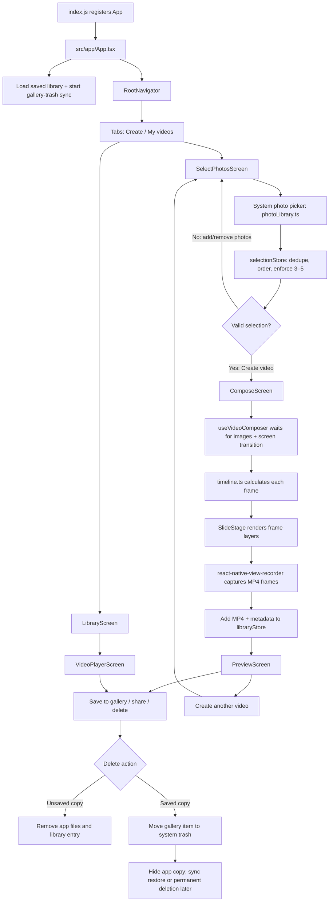

# Photo Sequence Video: Project Guide

This guide is a quick index of the app's code and the path a photo sequence
takes through it. The app is a React Native + TypeScript project. Its main
feature selects photos, renders them as a video with transitions and music,
and keeps the result in an in-app library.

## Start here

The native app entry point is [`index.js`](../index.js). It registers the
top-level `App` component. The root [`App.tsx`](../App.tsx) re-exports
[`src/app/App.tsx`](../src/app/App.tsx), which sets up app-wide providers and
starts the navigation tree.

The root component's important wiring is:

```tsx
useEffect(() => {
  useLibraryStore.getState().load();
}, []);

useGalleryTrashSync();

return (
  <SafeAreaProvider>
    <NavigationContainer theme={navigationTheme}>
      <RootNavigator />
    </NavigationContainer>
    <FeedbackHost />
  </SafeAreaProvider>
);
```

In other words, the library is loaded once when the app mounts, gallery trash
is synchronized as needed, and navigation and feedback are available to all
screens.

## Functional flow



### Walkthrough

1. **Boot:** `index.js` registers the app. `src/app/App.tsx` loads the library,
   installs trash synchronization, and mounts `RootNavigator`.
2. **Navigate:** `RootNavigator.tsx` defines a stack (`Tabs`, `Compose`,
   `Preview`, `Player`). `MainTabs.tsx` provides the `Create` and `Library`
   tabs.
3. **Choose photos:** `SelectPhotosScreen.tsx` calls `pickPhotos()` in
   `photoLibrary.ts`. The picker returns app-owned `Photo` objects;
   `selectionStore.ts` deduplicates them and caps the selection at
   `MAX_PHOTOS`. `validateSelection()` requires at least `MIN_PHOTOS`.
4. **Build the sequence:** `ComposeScreen.tsx` reads the selected photos and
   calls `useVideoComposer()`. It waits until the images have loaded and the
   navigation animation has completed before recording, so the recorder
   doesn't capture a partially entered screen.
5. **Render:** `timeline.ts` maps elapsed time/frame number to photo layers,
   opacity, horizontal offset, scale, and fades. `SlideStage.tsx` draws those
   layers. `useVideoComposer.ts` advances the frames in sync with React commits
   and asks `react-native-view-recorder` to encode the stage as H.264 video.
   The bundled background track is resolved by `backgroundMusic.ts`.
6. **Save and preview:** `ComposeScreen.tsx` gets output file paths from
   `libraryRepository.ts`. After recording, it adds metadata to
   `libraryStore.ts` and replaces the compose screen with `PreviewScreen.tsx`.
7. **Manage videos:** `LibraryScreen.tsx` lists visible videos;
   `VideoPlayerScreen.tsx` plays one. Both screens share save/share/delete
   behavior through `useVideoActions.ts`. Gallery restore and trash changes
   are reconciled by `useGalleryTrashSync.ts`.

### Rendering time example

`src/features/video-composer/config.ts` sets a 2.5-second hold and a 1-second
transition. The duration is calculated in
`src/features/video-composer/engine/timeline.ts`:

```ts
durationMs = photoCount * holdMs + (photoCount - 1) * transitionMs
```

For three photos, that's `3 × 2.5 + 2 × 1 = 9.5 seconds`. The transitions are
cycled in the configured order (`dissolve`, then `slide`).

## Key code to follow

### Selection validation

In `src/features/photo-selection/store/selectionStore.ts`:

```ts
export function validateSelection(count: number): SelectionValidation {
  if (count < MIN_PHOTOS) {
    const missing = MIN_PHOTOS - count;
    return {
      valid: false,
      reason: `Add ${missing} more photo${missing === 1 ? '' : 's'} to continue.`,
    };
  }
  if (count > MAX_PHOTOS) {
    return { valid: false, reason: `Pick at most ${MAX_PHOTOS} photos.` };
  }
  return { valid: true };
}
```

The limits live in `src/features/photo-selection/constants.ts` (`MIN_PHOTOS`
is 3 and `MAX_PHOTOS` is 5). The screen uses this validation both to explain
what is missing and to disable the create button.

### Frame-by-frame render orchestration

In `src/features/video-composer/hooks/useVideoComposer.ts`, each recorder frame
is paired with a React state update. `SlideStage.tsx` notifies the hook after
React has committed that frame; only then does the recorder capture it.

```ts
const frame = useMemo(
  () => timeline.stateAtFrame(frameIndex),
  [timeline, frameIndex],
);

const renderFrame = useCallback(
  (index: number) =>
    new Promise<void>(resolve => {
      if (committedFrame.current === index) {
        resolve();
        return;
      }
      pendingCommit.current = { frame: index, resolve };
      setFrameIndex(index);
    }),
  [],
);
```

This is why the render stage is a fixed `RecordingView` in
`ComposeScreen.tsx`: its pixels are the video image, so surrounding UI must
not scroll into or overlap it.

### Recording constraints

On Android, `react-native-view-recorder` copies the stage's on-screen pixels
(`PixelCopy`) and scales them to 720 × 1280. That has three consequences the
code relies on:

- **Resolution:** the stage is sized to exactly 720 physical pixels wide
  (`720 / PixelRatio.get()` points). A smaller stage would be upscaled and
  blurry.
- **Nothing on top:** anything drawn over the stage is recorded with it. The
  stage sits outside the scroll view, has no rounded clip, and keeps a top
  margin so toasts can't overlap it. Recording also waits for the screen's
  enter transition to finish.
- **Flattening:** animated photo layers use `collapsable={false}`; Fabric
  flattening while `zIndex` reorders siblings crashed the Android mount layer.

The library also needed fixes, kept in
`patches/react-native-view-recorder+0.4.1.patch` and reapplied by
`patch-package` on install:

- iOS: a Swift header clash with prebuilt React on RN 0.88, and audio that ran
  past the last video frame (the writer session is now ended at that frame).
- Android: `getCurrentActivity()` for RN 0.88.

The background track is a PCM WAV on purpose: the library's Android audio path
feeds file samples straight to the encoder as PCM, so a compressed file
(AAC/MP3) comes out as noise.

### Library persistence

`src/features/video-library/store/libraryStore.ts` owns the in-memory list.
`src/features/video-library/services/libraryRepository.ts` stores video and
thumbnail files under the app's Documents `library/` directory and the
metadata in `index.json`. The store serializes writes so rapid changes don't
overwrite each other:

```ts
let writeQueue: Promise<void> = Promise.resolve();

const persist = (videos: LibraryVideo[]): Promise<void> => {
  writeQueue = writeQueue.catch(() => {}).then(() => saveLibrary(videos));
  return writeQueue;
};
```

Gallery-saved videos use a soft delete: the app copy stays hidden while the
gallery copy is in system trash. `useGalleryTrashSync.ts` checks again on
startup and when the app returns to the foreground; restoring the gallery
copy makes the video visible again.

## Source index

### App setup and navigation

- `index.js` — registers the React Native app.
- `App.tsx` — root re-export to `src/app/App.tsx`.
- `src/app/App.tsx` — app providers, theme, library load, trash sync, feedback.
- `src/app/navigation/RootNavigator.tsx` — root stack screens and transitions.
- `src/app/navigation/MainTabs.tsx` — Create/Library tabs and library badge.
- `src/app/navigation/types.ts` — typed route parameters and screen props.

### Photo selection: `src/features/photo-selection/`

- `constants.ts` — minimum/maximum selection and picker image sizing.
- `screens/SelectPhotosScreen.tsx` — photo grid, selection controls, navigation.
- `services/photoLibrary.ts` — native picker adapter and `Photo` conversion.
- `store/selectionStore.ts` — selected-photo state, ordering, deduplication,
  and selection validation.

### Video composition: `src/features/video-composer/`

- `config.ts` — output size, frame rate, hold/transition/fade durations.
- `screens/ComposeScreen.tsx` — render screen, output target, library handoff.
- `hooks/useVideoComposer.ts` — image readiness, frame synchronization,
  snapshot, recorder, progress, cancellation, and errors.
- `engine/timeline.ts` — pure time/frame-to-visual-state calculations.
- `engine/easing.ts` — interpolation and easing helpers for frame motion.
- `engine/transitions.ts` — transition definitions (`dissolve`, `slide`).
- `components/SlideStage.tsx` — renders photo layers for the current frame.
- `components/RenderSteps.tsx` — render progress UI.
- `services/backgroundMusic.ts` — resolves the bundled music file for native
  recording.

### Export and gallery: `src/features/video-export/`

- `screens/PreviewScreen.tsx` — newly rendered video preview and actions.
- `hooks/useVideoActions.ts` — shared save, share, and delete behavior.
- `hooks/useGalleryTrashSync.ts` — app lifecycle listener and trash sync.
- `services/gallery.ts` — gallery permission and save-to-gallery adapter.
- `services/galleryTrash.ts` — platform gallery trash/status operations.

### Video library: `src/features/video-library/`

- `types.ts` — `LibraryVideo` metadata and render target types.
- `store/libraryStore.ts` — in-memory state, selectors, persistence calls,
  and gallery-trash reconciliation.
- `services/libraryRepository.ts` — Documents file paths, index parsing,
  loading, saving, target creation, and file cleanup.
- `services/trashPolicy.ts` — pure rules for restoring, retaining, or purging
  trashed videos.
- `screens/LibraryScreen.tsx` — saved-video grid.
- `screens/VideoPlayerScreen.tsx` — fullscreen playback and shared actions.
- `components/VideoCard.tsx` — library thumbnail and metadata card.
- `utils/format.ts` — display formatting for time and dates.

### Shared code: `src/shared/`

- `types/media.ts` — shared `Photo` type.
- `components/AppHeader.tsx`, `Button.tsx`, `HeaderButton.tsx`, `Pill.tsx` —
  reusable UI.
- `components/VideoPlayer.tsx` and `SeekBar.tsx` — player with minimal custom
  controls (play/pause, seekable progress bar, timestamp, optional
  fullscreen). The native controls are off because react-native-video 6.x
  ignores `controlsStyles` on Android.
- `feedback/index.ts`, `dialog.ts`, `toast.tsx`, `DialogHost.tsx`,
  `FeedbackHost.tsx` — app-wide toast/dialog feedback. Prefer `toast` and
  `dialog` over native alerts.
- `permissions/galleryPermission.ts`, `permissionDialog.ts` — gallery access
  checks and user-facing permission prompts.
- `theme/index.ts` — shared colors, spacing, typography, and radii.
- `icons.ts` — shared icon exports.
- `utils/files.ts`, `fs.ts`, `time.ts` — file URI, filesystem, and time helpers.

### Native/platform integration and project setup

- `android/app/src/main/java/com/photosequencevideo/MainActivity.kt` and
  `MainApplication.kt` — Android app entry and native package registration.
- `android/app/src/main/java/com/photosequencevideo/gallery/GalleryTrashModule.kt`
  and `GalleryTrashPackage.kt` — Android gallery trash/status native module.
- `ios/PhotoSequenceVideo/AppDelegate.swift` and `SceneDelegate.swift` — iOS
  app and scene lifecycle entry points.
- `assets/audio/background.wav` — background track used in rendered videos
  (bundled on iOS; copied to `android/app/src/main/assets/audio/` for
  Android); `scripts/generate-music.py` regenerates it.
- `patches/` — `patch-package` fixes for `react-native-view-recorder` (see
  Recording constraints).
- `package.json` — dependencies and Yarn scripts.
- `babel.config.js` and `tsconfig.json` — JavaScript/TypeScript configuration,
  including the `@/` alias to `src/`.
- `jest.config.js`, `jest.setup.js` and `__mocks__/lucideIcon.js` — test
  runner configuration and native-module mocks.

### Development and tests

- `src/dev/useE2ESeed.ts` — development/test photo seeding hook.
- `__tests__/App.test.tsx` — app root rendering.
- `__tests__/selectionStore.test.ts` — photo selection state and constraints.
- `__tests__/timeline.test.ts` — frame and duration math.
- `__tests__/videoLibrary.test.ts` — library persistence and policy behavior.
- `__tests__/galleryPermission.test.ts` — platform permission mapping.
- `__tests__/galleryTrashSync.test.ts` — gallery trash synchronization.
- `__tests__/dialog.test.tsx` — dialog behavior.

## Useful commands

Commands are defined in `package.json`:

```sh
yarn start                # Start Metro
yarn ios                  # Build and launch iOS
yarn android              # Build and launch Android
yarn lint                 # ESLint
yarn typecheck            # TypeScript check
yarn test                 # Jest tests
yarn android:apk          # Release APK -> dist/PhotoSequenceVideo.apk
yarn android:apk:install  # Install that APK on a USB-connected phone
```

## Known limitations

- **iOS is less tested than Android.** Rendering and export were verified on
  the iOS simulator, but the in-app preview player stayed black there (frames
  decoded, none displayed); this has not been checked on a device.
- **Sharing on Android:** React Native's `Share` can't send files on Android,
  so the Share button is iOS-only. `react-native-share` would add it.
- **Trash on iOS:** Recently Deleted items are hidden from apps, so a deleted
  video that is not restored is purged from the app after the same 30 days
  rather than when the user empties the trash.
- **Android 10 and below** have no system trash; deleting a saved video
  removes the gallery copy outright.
